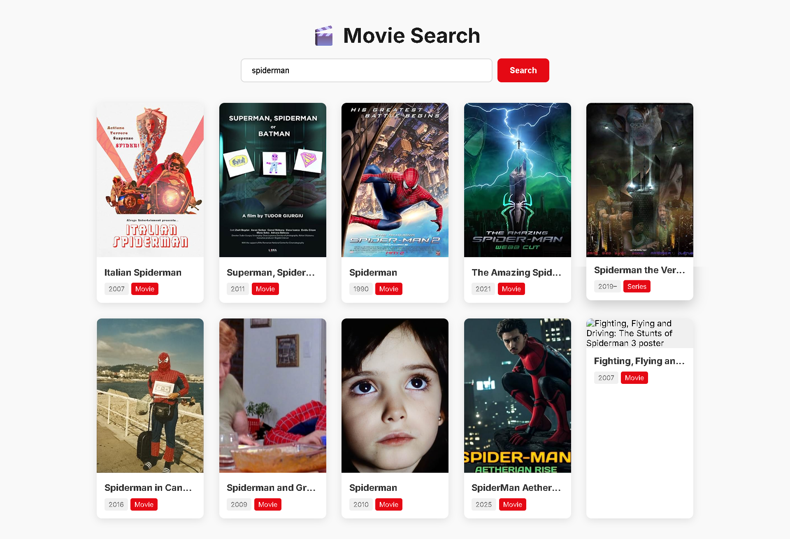

# Movie Search App (React)


A modern, fast, and responsive Movie Search application built with React and Vite. This is Project 4 of my 10-project developer portfolio series.


<!-- Replace the link above with your actual screenshot path -->

## 🚀 Live Demo

**[View the Live Website Here](https://your-live-link-here.netlify.app/)**
<!-- Update this link once deployed -->

## 📖 About The Project

This project marks my transition into modern frontend frameworks. It is a fully functional movie database search engine that fetches real-time data from the OMDb API.

The goal of this project was to master **React Fundamentals**, specifically functional components, React Hooks (`useState`, `useEffect`), and prop drilling. It demonstrates the ability to manage complex state (loading, error, and data states) and render dynamic UI components based on that state.

## ✨ Key Features

*   **Real-Time Search:** Fetches movie data dynamically from the OMDb API based on user input.
*   **Component-Based Architecture:** UI is broken down into reusable components (`App`, `MovieCard`).
*   **React Hooks:** Utilizes `useState` for form and data state, and handles asynchronous API calls.
*   **Responsive Grid Layout:** A beautiful CSS Grid that automatically adjusts the number of movie cards displayed based on screen size.
*   **Loading & Error States:** Gracefully handles loading spinners and displays user-friendly error messages (e.g., "Movie not found").
*   **Fallback Images:** If a movie poster is unavailable, it displays a placeholder image.

## 🛠️ Tech Stack

*   **React (v18+):** Functional components, Hooks (`useState`), Props.
*   **Vite:** Next-generation frontend tooling for fast builds.
*   **CSS3:** CSS Grid, Flexbox, hover animations.
*   **OMDb API:** For fetching real movie data.

## ⚙️ How to Run Locally

1. Clone the repository:
   ```bash
   git clone https://github.com/waseemqureshi2020/movie-search-app.git